# CHPLI 系统描述（System Description）

> 本文档用 9 组 Mermaid 图描述 CHPLI 当前（2026-11）已交付功能的架构全景。
> 涵盖：系统上下文、容器架构、部署视图、Module Federation 拓扑、页面路由、后端模块协作、全局 ER、关键状态机、核心时序。
> 阅读顺序建议：上下文 → 容器 → 拓扑 → 路由（前端）→ 模块协作 / ER（后端）→ 状态机 / 时序（关键机制）。

---

## 1. 系统上下文图（C4 Level 1）

CHPLI 是一个个人生活与成长管理系统。最终用户通过浏览器访问（未来可能嵌入 Portal 平台的 WebView）；系统唯一的后端是 NestJS 模块化单体；数据落在 PostgreSQL，文件落在 MinIO；LLM 网关为已设计未接入的可选能力。

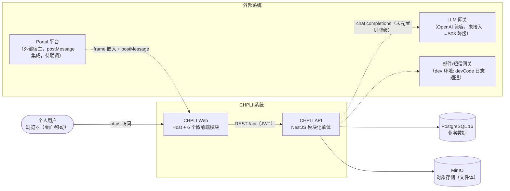

## 2. 容器架构图（C4 Level 2）

7 个可独立启动的前端容器 + 1 个后端容器 + 2 个共享包 + 1 个基础设施层。Host 通过 Module Federation 在**运行时**加载 6 个 Remote；`@chpli2/shared` / `@chpli2/ui` 以 TS 源码方式被所有前端消费（不构建不发布）。

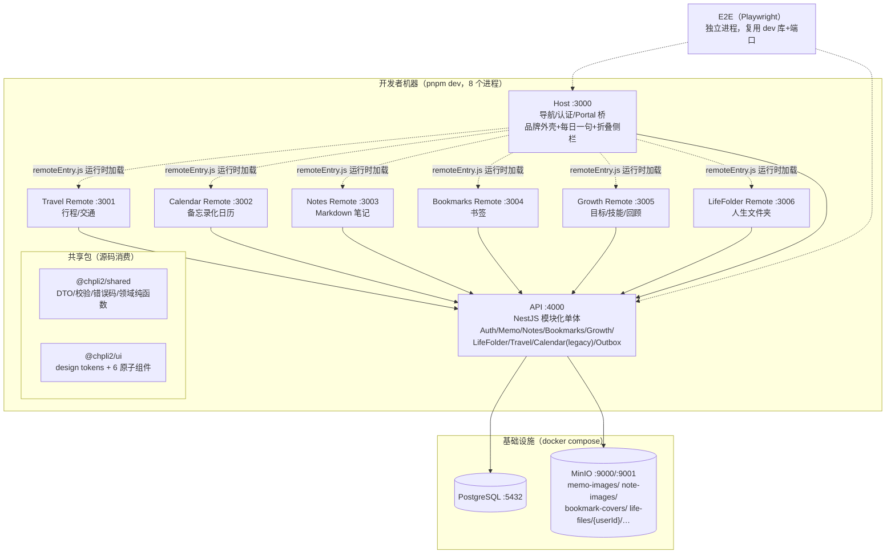

## 3. 部署视图

当前只有本地开发部署（实测形态）；生产为规划目标（单 VPS 全栈部署，对应 Developer-Tutorial 第 8 章）。

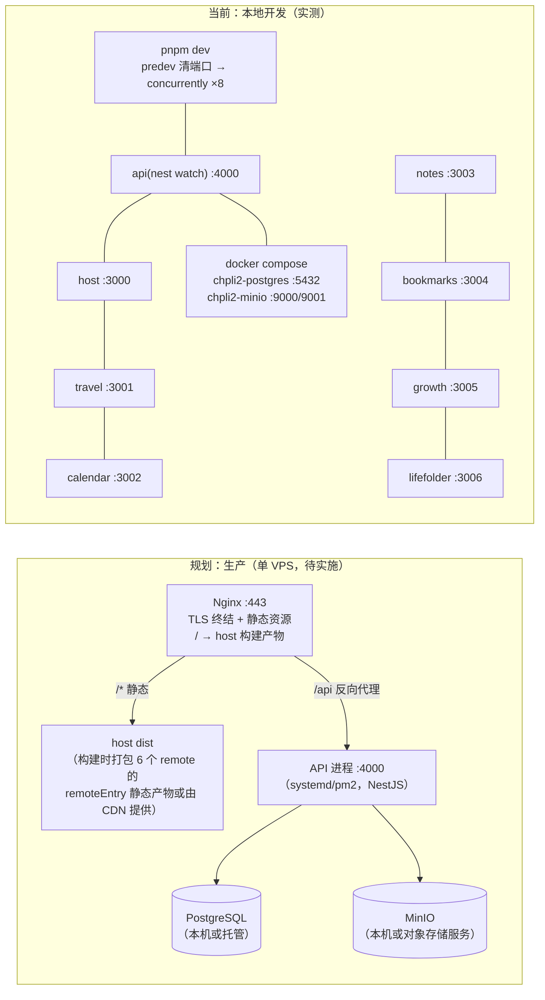

## 4. Module Federation 拓扑图

Host 是唯一的 MF **入口**（react/react-dom 以 singleton+eager 共享）；Remote 的 `index.tsx` 只有异步边界（防 RUNTIME-006）。MF DTS 类型共享为已知噪音（TYPE-001，不影响运行）。

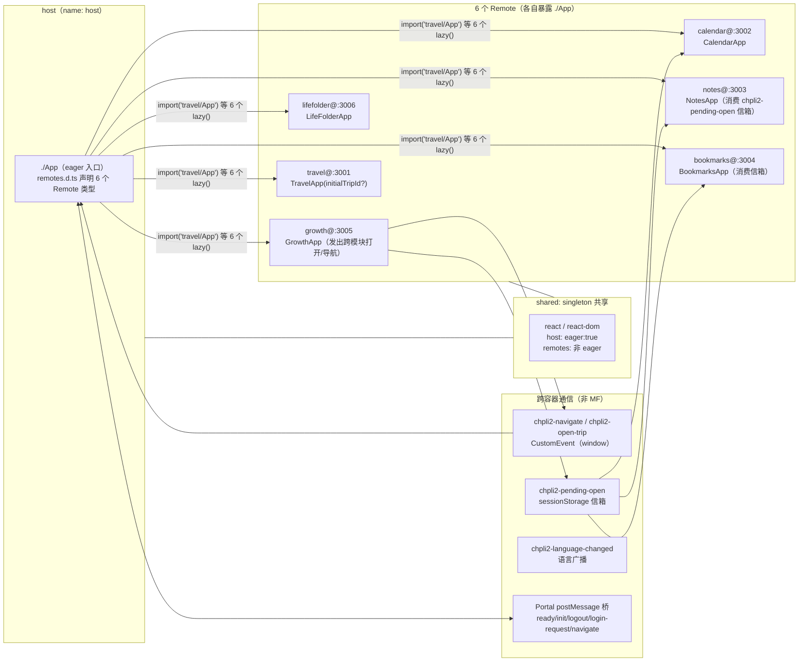

## 5. 页面路由图

Host **不使用 URL 路由**：视图是 React state（`view` + `tripId`），因此刷新总是回到首页——这是当前的有意取舍（刷新恢复见状态机时序外的 localStorage 偏好）。各 Remote 内部有自己的视图状态。

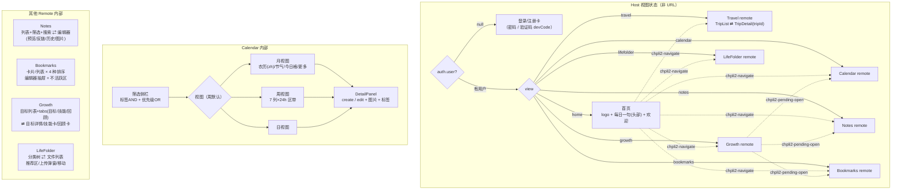

## 6. 后端模块协作图

模块化单体：一个进程、一个数据库，按模块隔离。协作纪律：**跨模块只经对方模块公开的 Service 或领域事件（Outbox），绝不直改对方数据表**。

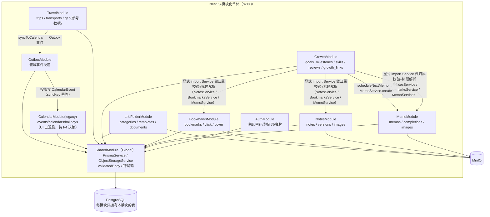

## 7. 全局 ER 图

28 张表。文件类实体（memo_images / note_images / bookmarks.cover / lf_documents）**只存元数据+存储键**，文件体在 MinIO（图中以虚线示意）。`growth_links` 为多态关联（ownerType × module），无外键；`reviews.nextMemoId → memos` 为软关联（悬挂自愈）。

```mermaid
erDiagram
    users ||--o{ trips : owns
    users ||--o{ calendars : owns
    users ||--o{ memos : owns
    users ||--o{ notes : owns
    users ||--o{ bookmarks : owns
    users ||--o{ goals : owns
    users ||--o{ skills : owns
    users ||--o{ reviews : owns
    users ||--o{ lf_categories : owns
    users ||--o{ lf_documents : owns
    users ||--o{ login_codes : "verify"

    calendars ||--o{ events : has
    events ||--o{ reminders : has
    trips ||--o{ transports : has

    Country ||--o{ City : has
    City ||--o{ Location : has

    memos ||--o{ memo_completions : "@@unique(memoId,date)"
    memos ||--o{ memo_images : has
    notes ||--o{ note_versions : "每保存一版"
    notes ||--o{ note_images : has
    goals ||--o{ milestones : has
    goals ||--o{ skills : "optional goalId"
    goals ||--o{ reviews : "optional goalId"
    lf_categories ||--o{ lf_documents : has

    users {
        text id PK
        text username "unique"
        text email "unique, nullable"
        text phone "unique, nullable"
        text password_hash "nullable(验证码登录)"
    }
    memos {
        text id PK "客户端生成"
        text user_id FK
        date date "纯日期,无时区"
        text priority "none|low|medium|high"
        text repeat "none + 9 种规则"
        date repeat_end "nullable, 含当天"
        text[] tags "<=10 个"
    }
    memo_completions {
        text memo_id FK
        date date
    }
    notes {
        text id PK "客户端生成"
        text body "<=100KB"
    }
    note_versions {
        text note_id FK
        int seq "每篇保留最近50版"
    }
    bookmarks {
        text id PK
        text domain "从 url 归一化"
        int click_count
        timestamp last_clicked_at "inactive>=30天"
    }
    goals {
        text id PK
        text status "active|paused|achieved|archived"
        int progress "派生: done/total"
    }
    skills {
        text name "每用户 unique"
        int level "0..5"
    }
    reviews {
        text id PK
        date reviewed_at
        text next_memo_id "软关联 memos, 悬挂自愈"
    }
    growth_links {
        text owner_type "goal|skill|review"
        text module "notes|bookmarks|memos"
        text ref_id "多态, 无 FK"
    }
    lf_documents {
        text id PK "客户端生成"
        text storage_key "→ MinIO"
        bool sensitive "默认 true"
    }
    lf_categories_extra["lf_categories.parentId → 自身(树深≤2, 无 FK 查询约束)"]
    transports {
        text trip_id FK
        text mode "FLIGHT|TRAIN|BUS|…"
        text origin_level "COUNTRY|CITY|LOCATION"
        bool sync_to_calendar
    }
    OutboxEvent {
        text type "领域事件"
        text payload "JSON"
        timestamp processed_at "nullable"
    }

    minio_object {
        text key PK "bucket/userId/id.ext"
    }
    memos }o--o{ growth_links : "逻辑关联(module=memos, 无FK)"
    notes }o--o{ growth_links : "逻辑关联(module=notes, 无FK)"
    bookmarks }o--o{ growth_links : "逻辑关联(module=bookmarks, 无FK)"
    lf_documents }o--|| minio_object : "storage_key"
    memo_images }o--|| minio_object : "storage_key"
    note_images }o--|| minio_object : "storage_key"
```

## 8. 关键状态机图

### 8.1 目标状态（手动流转，里程碑全完成**不**自动改状态）

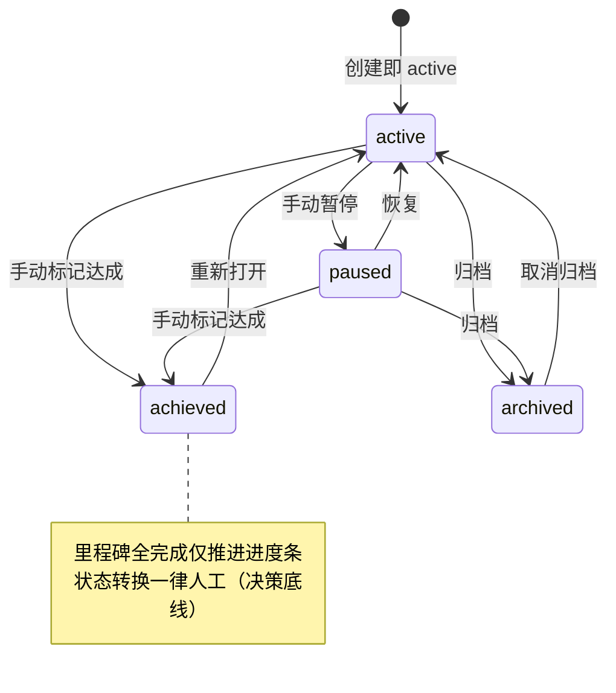

### 8.2 交通段日历同步（syncKey 幂等投影）

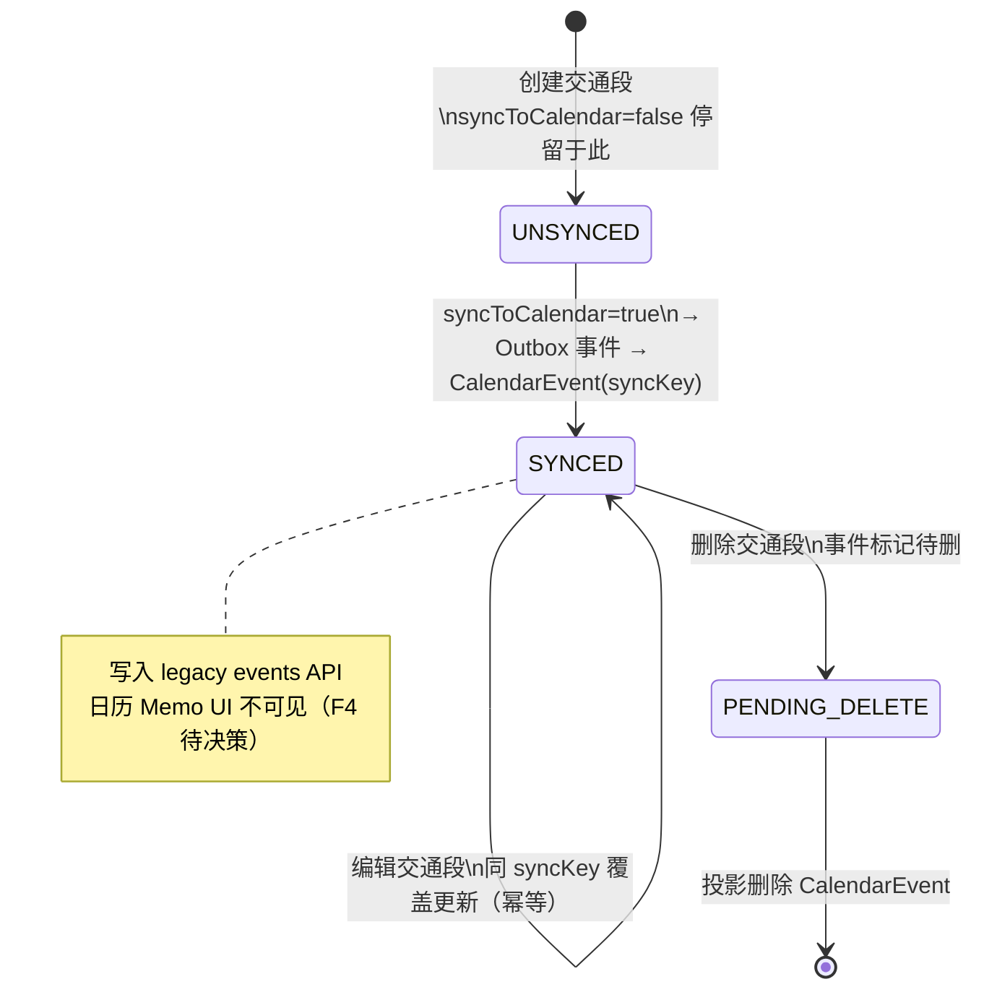

### 8.3 回顾的下次安排（幂等 + 悬挂自愈）

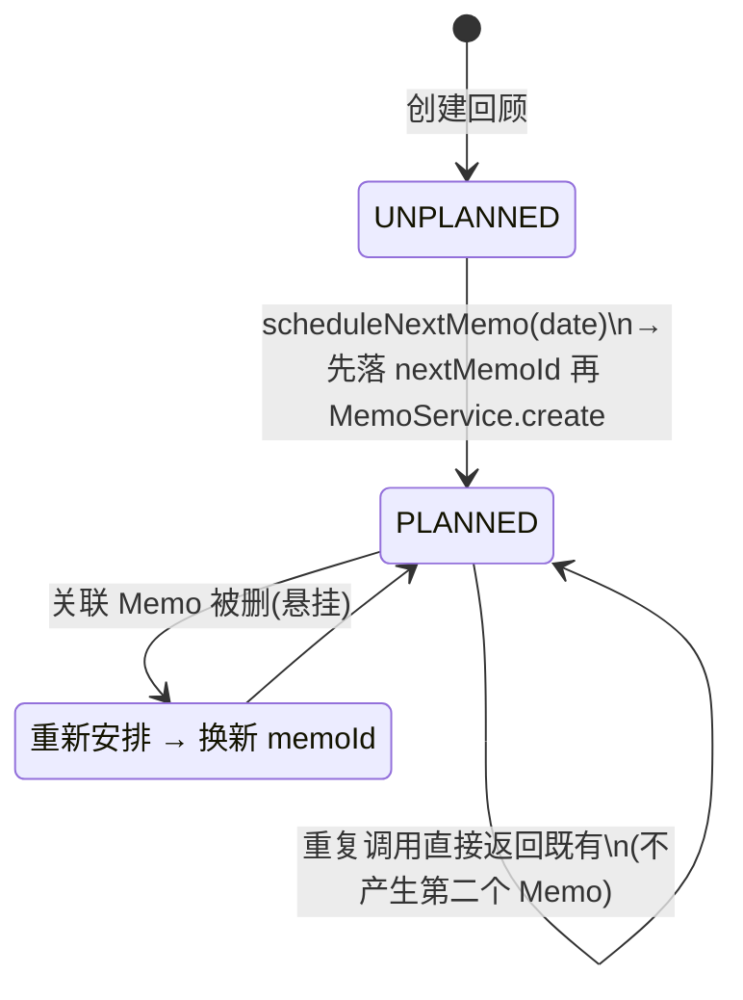

### 8.4 书签活跃性（派生态，非存储状态）

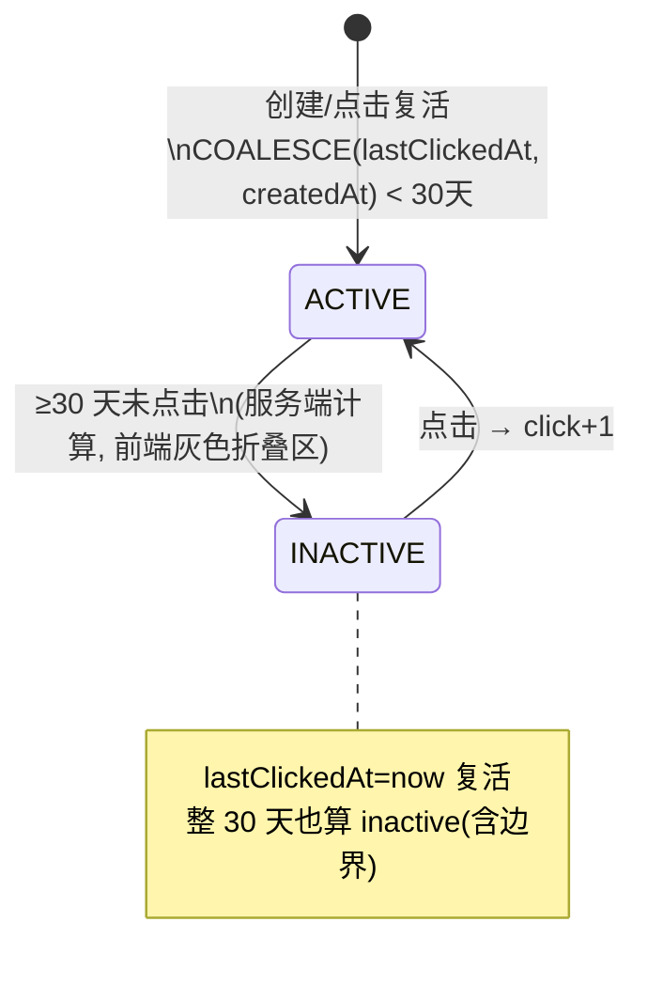

## 9. 核心时序图

### 9.1 创建备忘录（客户端幂等 + 乐观锁）

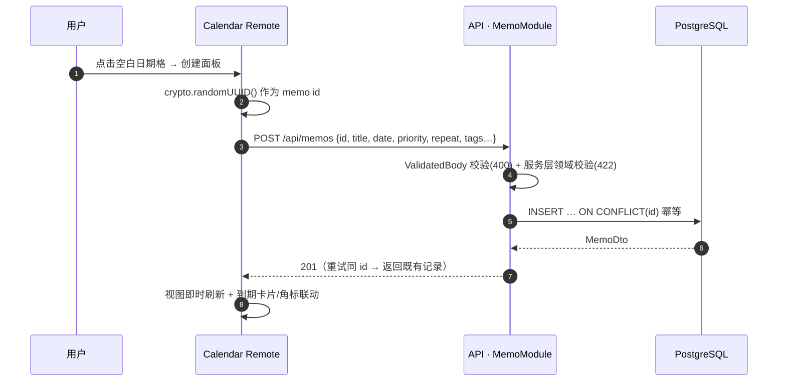

### 9.2 Travel → 日历同步（Outbox 投影，syncKey 幂等）

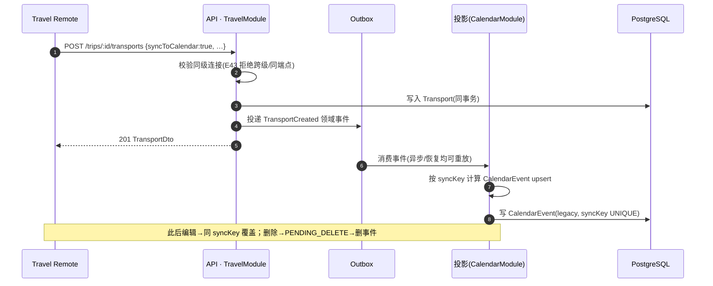

### 9.3 Portal 模式登录握手（trust but verify）

```mermaid
sequenceDiagram
    autonumber
    participant P as Portal(父帧)
    participant H as Host App
    participant A as API · AuthModule

    P->>H: chpli2:portal:init {token} (origin 白名单校验)
    H->>H: 先写 localStorage, 不盲信
    H->>A: GET /api/auth/me (Bearer token)
    alt 令牌有效
        A-->>H: UserDto
        H->>H: 进入应用(永不渲染本地登录卡)
    else 令牌无效
        A-->>H: 401
        H->>P: chpli2:portal:login-request
        H->>H: 「等待 Portal 登录」占位
    end
    H->>P: chpli2:portal:ready (握手, 500ms 超时回退独立模式)
    Note over P,H: 登出双向: 用户在 CHPLI 登出→notifyLogout;\nPortal 终止会话→logout 信号→清本地态
```

### 9.4 成长模块跨模块打开链接（信箱 + 导航事件）

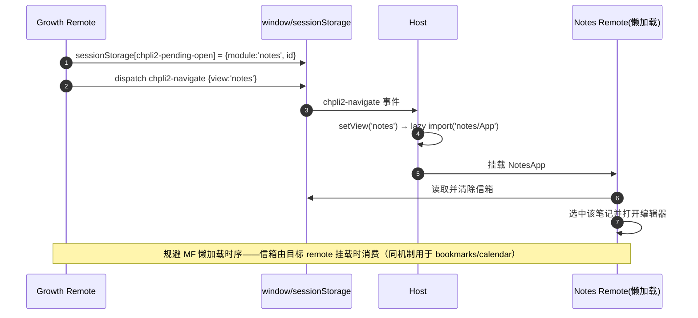

---

*本文档随交付迭代更新；新增模块/表/协议时同步补充对应图示。*
